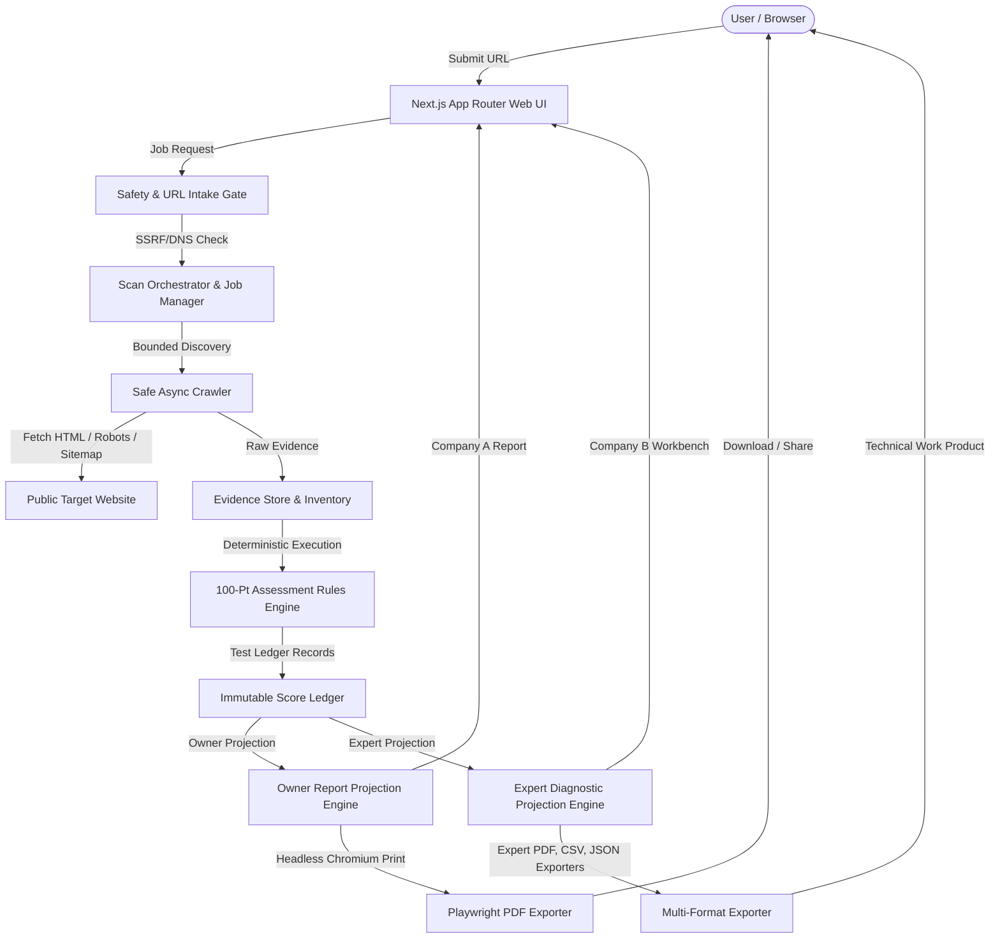

# SiteIntel Pulse — System Architecture

## 1. Architectural Philosophy
SiteIntel Pulse is designed as a **modular monolith** with clear operational boundaries. In Milestone 1, the platform delivers a secure, non-invasive website scanner and a business-oriented Website Owner Report generator for Company A. The underlying data model, evidence ledger, and score engine are architected to support Milestone 2 (Company B Expert Diagnostic Workbench) without schema rewrites or dual scoring logic.

## 2. Core Subsystems

### 2.1 URL Intake & Safety Gate (`src/lib/scanner/`)
- **URL Normalizer & Validator:** Accepts bare domains (`example.com`) or full URLs (`https://example.com`), canonicalizes protocol, removes dangerous credentials/fragments.
- **DNS Safety & Anti-SSRF:** Queries all A/AAAA records. Strictly blocks loopback (`127.0.0.0/8`), private networks (`10.0.0.0/8`, `172.16.0.0/12`, `192.168.0.0/16`), link-local (`169.254.0.0/16`), cloud metadata (`169.254.169.254`, `metadata.google.internal`), and IPv6 equivalents (`::1`, `fc00::/7`, `fe80::/10`).
- **Redirect Revalidation:** Every redirect hop is re-validated through the DNS safety gate before fetching.

### 2.2 Bounded Crawler & Discovery (`src/lib/scanner/crawler.ts`)
- **Budget Control:** Enforces strict limits: default 50 pages (hard cap 100), max crawl depth 3, max concurrency 3, max decompressed page size 2 MiB, max total scan size 50 MiB.
- **Robots & Sitemap Parsing:** Honors robots.txt disallow directives; discovers XML sitemaps and sitemap indexes.
- **Safe HTML Extraction:** Cheerio-based deterministic parsing. Never executes downloaded JavaScript in Node.js.

### 2.3 Assessment Catalogue & Scoring Engine (`src/lib/catalogue/`, `src/lib/scoring/`)
- **Versioned Rules Catalogue:** 56 tests across 11 categories totaling exactly 100 maximum points.
- **Pure Deterministic Calculation:** Category score = `100 * earnedPoints / testedApplicablePoints`. Overall score is the weighted composite of eligible categories.
- **Coverage Rules:** Provisional labeling applied when weighted evaluation is under 70% of catalogue or any category under 60%.

### 2.4 Owner Report Projection & PDF Engine (`src/lib/reports/owner-projection.ts`)
- **Audience Separation:** Projects raw observations into business-level opportunity themes, platform profile, and executive summaries for Company A.
- **PDF Generation:** Playwright Chromium headless render with dedicated print CSS. Reconciles 100% with the web dashboard data.

### 2.5 Expert Diagnostic Workbench & Multi-Format Exporter (`src/lib/reports/expert-projection.ts`, `expert-export.ts`, `expert-pdf-generator.ts`)
- **19 Integrated Diagnostic Sections:** Page-level URL diagnostics, technical SEO, heading outlines, JSON-LD Schema inspector, link architecture, Web Vitals, 7-viewport responsive matrix, security headers, authentication posture, and AI bot crawler policies.
- **Finding Ledger & Remediation Plan:** Multi-facet filtering (Category, Severity, Status, Workstream), DOM selectors, technical impact, business impact, and P0-P3 specialist workstreams with validation procedures.
- **Multi-Format Exports:** High-fidelity A4 Expert PDF, CSV Findings, CSV URL Inventory, CSV Remediation Tasks, JSON Bundle, and Cryptographic Manifest with SHA-256 integrity checksum.
